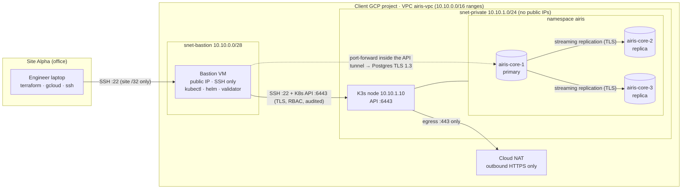

# Site Alpha: Airis Core phase 1 (GCP · Terraform · K3s · CloudNativePG)

A Zero Trust, bastion-only deployment of a PostgreSQL data layer on a fresh GCP project:

- **Day 0:** secure infrastructure and cluster bring-up
- **Day 1:** validation, failover proof and a handover report for the client's security team

> Prepared in advance as the brief suggests ("you do not need a fully polished solution before arriving").
> Everything here is meant to be walked through and changed live. Each file explains *why* it is the way it is.



## What makes it Zero Trust

| Layer | Control |
|---|---|
| Edge | Only TCP/22 to the bastion, only from the site's egress IP (or no public IP at all: IAP mode) |
| Network | K3s node has no public IP. Bastion → node allows only 22 and 6443. Logged explicit deny-all, in and out |
| Egress | K3s node may only open TCP/443 via Cloud NAT (registries); everything else is denied and logged |
| Identity | No VM service accounts. SSH via one engagement key (or OS Login). Validator runs with a namespace-scoped, read-only, 8-hour token |
| Kubernetes | No ingress controller, no LoadBalancer, Pod Security `baseline` enforced, Secrets encrypted at rest, API audit log |
| Database | TLS-only (`hostnossl … reject`), SCRAM passwords, no remote superuser, client verifies the server certificate (verify-full) |
| Evidence | Validator proves both what works and what must not work, and writes a JSON report with no secrets |

## Repository map

| Path | Runs on | Purpose |
|---|---|---|
| `terraform/` | laptop | VPC, 2 subnets, firewall, Cloud NAT, bastion VM, K3s VM |
| `scripts/00-preflight.sh` | laptop | Login, project, APIs, org policies, quota, egress IP, SSH key → writes `terraform.tfvars` |
| `scripts/k3s-install.sh` | K3s node | Hardened K3s install (startup script or by hand) |
| `scripts/10-ssh-config.sh` | laptop | Generates `.local/ssh_config` (ProxyJump through the bastion) and tests both hops |
| `scripts/20-bootstrap-bastion.sh` | laptop | Copies the kit, installs tools on the bastion, moves the kubeconfig node → bastion |
| `scripts/30-deploy-db.sh` | bastion | CNPG operator (Helm), namespace, Postgres cluster, public CA, validator RBAC |
| `scripts/40-validator-kubeconfig.sh` | bastion | Short-lived least-privilege kubeconfig for the validator |
| `validator/validate.py` | bastion | Day-1 proof and handover report (16 checks) |
| `scripts/failover-demo.sh` | bastion | Kill the primary, measure promotion time |
| `scripts/collect-diagnostics.sh` | bastion | Support bundle for troubleshooting |
| `scripts/99-cleanup-laptop.sh` | laptop | Remove keys and credentials from a borrowed laptop |
| `k8s/` | bastion | Namespace, `Cluster` CR, validator RBAC, optional NetworkPolicy |
| `docs/` | - | [architecture](docs/architecture.md) · [deployment runbook](docs/deployment-runbook.md) · [troubleshooting](docs/troubleshooting.md) · [DB sizing](docs/db-sizing.md) · [validator](docs/validator.md) · [tool installation](docs/tool-installation.md) |

## Fast path on site (about 25 minutes of machine time)

```bash
git clone <this repo> && cd site-alpha-deploy
gcloud auth login && gcloud auth application-default login
PROJECT_ID=<client-project> ./scripts/00-preflight.sh        # review terraform/terraform.tfvars
terraform -chdir=terraform init
terraform -chdir=terraform plan -out=tfplan                     # read the plan out loud
terraform -chdir=terraform apply tfplan                         # ~2-3 min
./scripts/10-ssh-config.sh                                      # laptop -> bastion -> node
./scripts/20-bootstrap-bastion.sh                               # tools + kubeconfig on bastion

ssh -F .local/ssh_config airis-bastion
cd ~/airis
./scripts/30-deploy-db.sh                                       # ~3-5 min
./scripts/40-validator-kubeconfig.sh
.venv/bin/python validator/validate.py --kubeconfig ~/.kube/validator.kubeconfig
./scripts/failover-demo.sh && .venv/bin/python validator/validate.py
```

## Pinned versions (verified October 2026)

| Component | Version | Why this one |
|---|---|---|
| Terraform google provider | `~> 7.0` | Current major |
| K3s | `v1.35.7+k3s1` | Kubernetes 1.35, in the middle of CNPG 1.30's supported range (1.34–1.36) |
| CloudNativePG | chart `0.29.1` → operator `1.30.1` | Latest release |
| PostgreSQL | `18.6` (`ghcr.io/cloudnative-pg/postgresql:18.6-system-trixie`) | Operator 1.30.1's default image |
| Helm | `v4.3.0` | Latest |
| kubectl | latest `1.35.x` | Same minor version as the API server |
| psycopg | `3.3.6` | The validator's only dependency |

## What was tested, and what wasn't

- **Tested:** `validator/validate.py` ran end-to-end against a real PostgreSQL primary and two streaming replicas. The test setup used TLS 1.3, SCRAM and a TLS-only `pg_hba`, through a simulated Kubernetes API, in 8 scenarios: healthy, NodePort exposed, CA fallback, least-privilege identity, degraded cluster, hostname mismatch, plaintext accepted and replica down. See `validator/tests/`.
- **Static checks:** Terraform parses cleanly and Checkov reports 53 passed, 0 failed, with 3 documented exceptions. The Kubernetes manifests passed 13 Checkov checks. Shell scripts are shellcheck-clean and Python is ruff-clean.
- **Requires a live environment:** `terraform apply` on GCP and the K3s/CNPG install are validated by a full run in a sandbox GCP project (see [deployment runbook](docs/deployment-runbook.md)).
